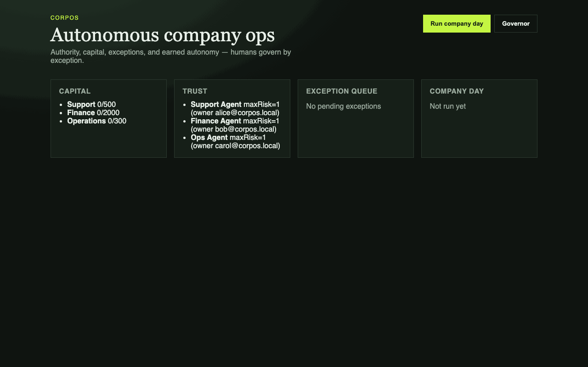
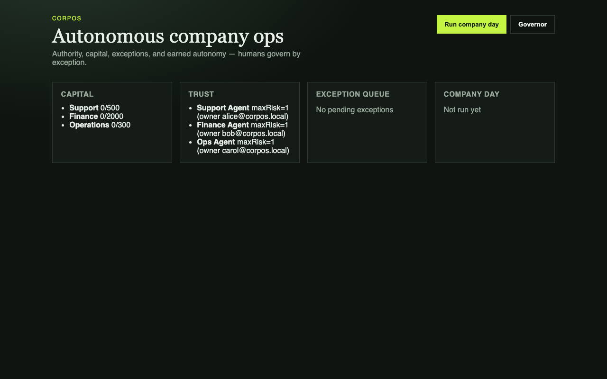
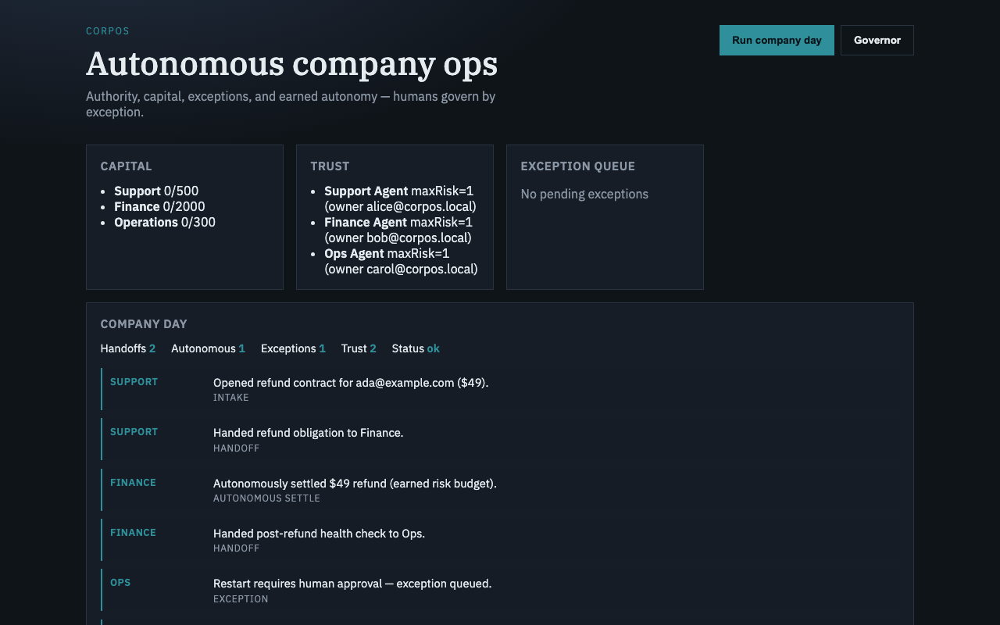
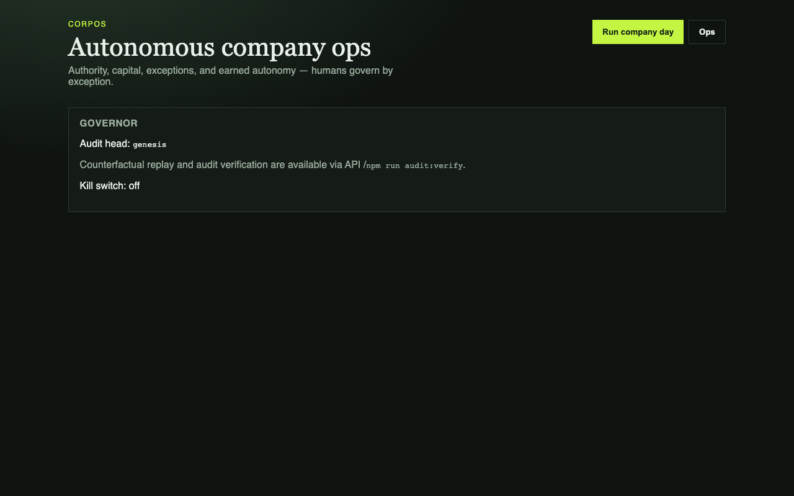

# CorpOS

One scripted company day. Support hands a $49 refund to Finance. Finance settles `billing.issue_refund` through the tool gateway and hands the work to Ops. Ops queues `ops.restart_service` for billing-api. The refund stays on the ledger. The restart stays queued until Approve, Reject, or Kill.

`POST /api/company-day` runs that day. It does not settle the restart, and it does not honor `autoApproveException` from the JSON body. An unauthenticated caller cannot auto-approve.

[](https://github.com/SafetyMP/CorpOS/actions/workflows/ci.yml)
[](https://github.com/SafetyMP/CorpOS/actions/workflows/codeql.yml)
[](https://scorecard.dev/viewer/?uri=github.com/SafetyMP/CorpOS)
[](LICENSE)
[](#quick-start)

**Jump to:** [Demo](#demo) · [Quick start](#quick-start) · [Architecture](#architecture) · [Contributing](CONTRIBUTING.md) · [Security](SECURITY.md) · [ADRs](docs/adr/README.md)

---

## Demo

<p align="center">
  
</p>

### Screenshots

|             Ops             |               Company day               |               Governor                |
| :-------------------------: | :-------------------------------------: | :-----------------------------------: |
|  |  |  |

- **Local demo:** `npm install && npm run build && npm run dev` → [http://localhost:3000](http://localhost:3000)
- **Regenerate GIF/PNGs:** start the console, then `npm run screenshots` — see [`docs/assets/README.md`](docs/assets/README.md)

Click **Run company day** to watch the activity timeline: support → finance → ops. The refund stays in place. The service restart stays queued until Approve, Reject, or Kill.

---

## Quick start

```bash
npm install
npm run build
npm run dev        # ops console on $PORT or 3000
```

Contributors and CI should use `npm ci --include=dev` (see [CONTRIBUTING.md](CONTRIBUTING.md)).

```bash
npm test
npm run scenario                 # default day exits 0: refund stays, restart stays queued
npm run audit:verify
./scripts/harness/verify.sh      # functional / static acceptance
./scripts/harness/adversarial.sh # authorized local adversarial probes (CI also runs this)
```

### Container

```bash
docker build -t corpos .
docker run --rm -p 3000:3000 corpos
```

CI may publish images to `ghcr.io/safetymp/corpos` (tags: branch, sha, semver, `latest`). Optional Fly.io deploy runs from [`.github/workflows/deploy.yml`](.github/workflows/deploy.yml) on GitHub release when `FLY_API_TOKEN` is set — see [`fly.toml`](fly.toml).

## Architecture

| Layer                 | Package / app           | Responsibility                                        |
| --------------------- | ----------------------- | ----------------------------------------------------- |
| Firm / work / control | `@corpos/core`          | Contracts, gateway, policy, trust, audit, company day |
| MCP knowledge         | `@corpos/mcp-knowledge` | Real local MCP server (stdio)                         |
| API                   | `@corpos/api`           | Hono REST + SSE                                       |
| Ops console           | `@corpos/console`       | Vite + Preact                                         |

Stack: Node ≥22 · TypeScript · npm workspaces · Hono · Drizzle + libsql · official MCP SDK · Preact. No Express, no `better-sqlite3`, no agent-framework lock-in.

Architecture decisions live in [`docs/adr/README.md`](docs/adr/README.md).

## Security

Reference architecture — not production-hardened. `DASHBOARD_API_TOKEN` is required for approve/kill mutations by default; `CORPOS_MODE=local` does not skip the bearer gate. Decide/appeal bind the decider and tenant to `DASHBOARD_OPERATOR_ID` / `DASHBOARD_TENANT_ID`, not the request body. Set `CORPOS_ALLOW_UNAUTHENTICATED=true` only for local simulation. See [SECURITY.md](SECURITY.md).

## Community

[Contributing](CONTRIBUTING.md) · [Code of Conduct](CODE_OF_CONDUCT.md) · [Security](SECURITY.md) · [ADRs](docs/adr/README.md)

## License

Apache-2.0 — Copyright © 2026 SafetyMP.


## Documentation map

[docs/README.md](docs/README.md) is the documentation index. Community policy files are the root `CONTRIBUTING.md`, `CODE_OF_CONDUCT.md`, and `SECURITY.md`.
